# Predicting milling-machine failures and choosing when to stop the machine

**IDSE course project, Part A** · Dataset: AI4I 2020 Predictive Maintenance (UCI) · All numbers below are produced by `python run_pipeline.py` with seed 42.

## Summary

From sensor readings taken at the start of a job, a tuned gradient boosting model on three physics-based features catches **65 of 68 failures (95.6%)** in 2,000 unseen jobs. It raises 120 false alarms (6% of healthy jobs). At an assumed ₹50,000 per missed failure and ₹2,000 per false alarm, it cuts the cost of mistakes from **₹34.0 lakh** (no model) and **₹24.0 lakh** (replace tools at 200 min) to **₹3.9 lakh**, an 84–89% saving. The ranking holds for cost ratios from 5:1 to 100:1. What helped most was feature engineering, then choosing the alarm threshold by cost. Hyper-parameter tuning added little.

## 1. Problem and goals

A milling machine logs air and process temperature, spindle speed, torque and tool wear for every job, and a small share of jobs end in a failure. Missing a failure costs an unplanned breakdown. A false alarm costs a short stop and inspection.

**Question.** Can we flag the jobs likely to fail, and where should the alarm threshold sit so that the total cost of mistakes is lowest?

**Measurable goals**

1. Beat two baselines on held-out data: *never alarm*, and the common shop rule *replace the tool at 200 min*.
2. Report the cost in rupees, and show the conclusion survives cost ratios from 5:1 to 100:1.
3. Explain which failure types are caught or missed, and which operating region is unsafe.

## 2. Data

| | |
| --- | --- |
| Source | [UCI ML Repository, dataset 601](https://archive.ics.uci.edu/dataset/601/ai4i+2020+predictive+maintenance+dataset); Matzka, AI4I 2020 conference; CC BY 4.0 |
| Size | 10,000 jobs × 14 columns |
| Features | Type (L/M/H quality), air temperature (K), process temperature (K), speed (rpm), torque (Nm), tool wear (min) |
| Target | Machine failure (1 = failed): 339 jobs, **3.39%** |
| Failure-mode flags | Tool wear (46), heat dissipation (115), power (95), overstrain (98), random (19) |

**Why this dataset.** It is a public, peer-reviewed benchmark about machining, so it is relevant to mechanical engineering. It is large enough for a locked test set plus 5-fold cross-validation, and it is less common than classroom datasets. It is **synthetic**: the authors generated it from documented physical rules because real failure logs are rarely published. Section 8 discusses what that means for the results.

## 3. Data preparation

| Check | Finding | Decision and reason |
| --- | --- | --- |
| Types | Type is text; flags are 0/1 | Type became an ordered category (L < M < H), then one-hot encoded inside the model pipeline |
| Missing values | None | No imputation needed. A median imputer still sits inside the pipeline, fitted on training folds only |
| Duplicates | None (ignoring IDs) | Nothing removed |
| IDs | UDI and Product ID; Product ID's first letter always equals Type | Not used as features |
| Label consistency | 9 failures with no mode flagged; 18 random-failure flags on jobs that did *not* fail | Machine failure kept as ground truth; modes used only for error analysis |
| Leakage | The five mode flags are known only after a failure | Excluded from the features |
| Outliers (1.5×IQR) | 418 speed and 69 torque readings | **Kept.** Flagged torque rows fail 90% of the time (vs 2.8% elsewhere); they are the signal, not noise |

## 4. Exploratory analysis

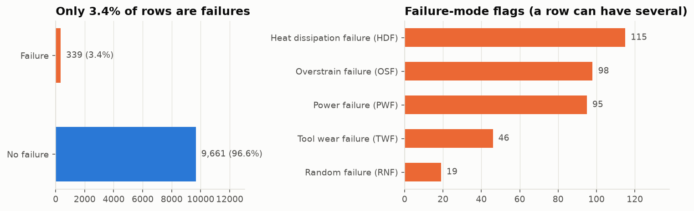

Only 3.4% of jobs fail, so a model that always says "no failure" would be 96.6% accurate and useless. Accuracy is therefore not used to choose models.

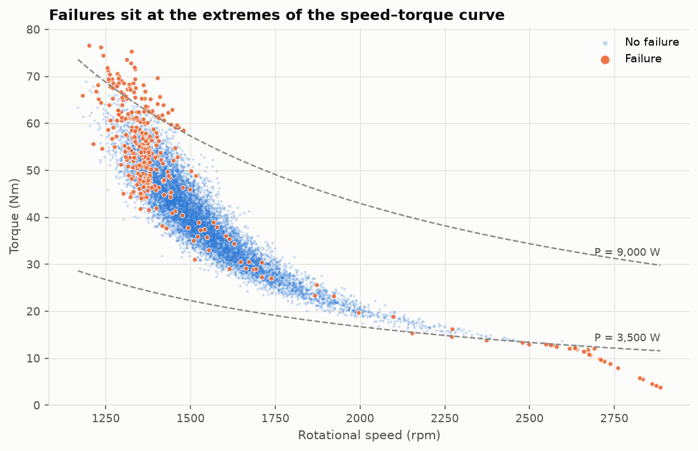

The machine runs near constant power: torque × speed ≈ constant, the hyperbola above. Failures sit at both ends of it: high torque at low speed (above about 9 kW) and low torque at high speed (below about 3.5 kW). Linear correlation with failure never exceeds 0.19, because a two-sided pattern like this is invisible to a correlation coefficient. That pointed us towards tree models.

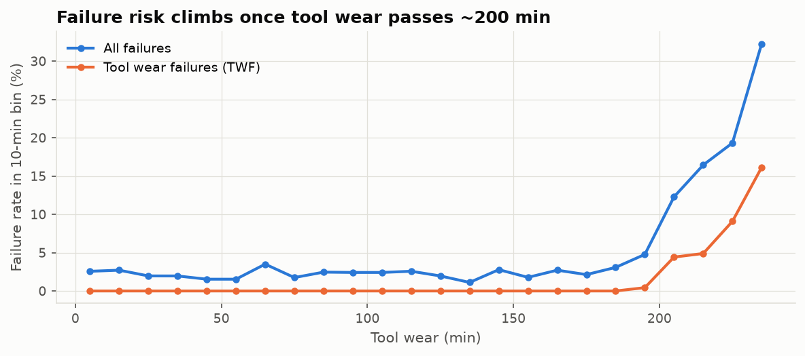

The failure rate stays at 1–3.5% until about 180 min of wear. It reaches 12% at 200–210 min and 32% at 230–240 min. Tool-wear failures appear only from 198 min. L parts fail at 3.9%, M at 2.8% and H at 2.1%, so Type is kept as a feature.

## 5. Feature engineering

| Feature | Formula | Failure mode it isolates |
| --- | --- | --- |
| Spindle power (W) | torque × rpm × 2π/60 | Power failure: below about 3,500 W or above about 9,000 W |
| Temperature difference (K) | process − air temperature | Heat dissipation: below about 8.6 K together with under 1,380 rpm (all 115 cases) |
| Wear × torque (min·Nm) | tool wear × torque | Overstrain: above about 11,000 for L parts, more for M and H |

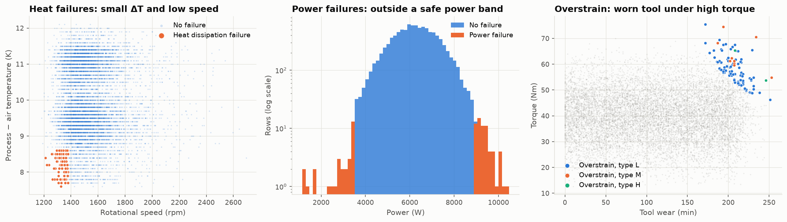

Each feature turns a curved boundary in raw-sensor space into a single cut. All three are computed row by row, so they cannot leak information between train and test.

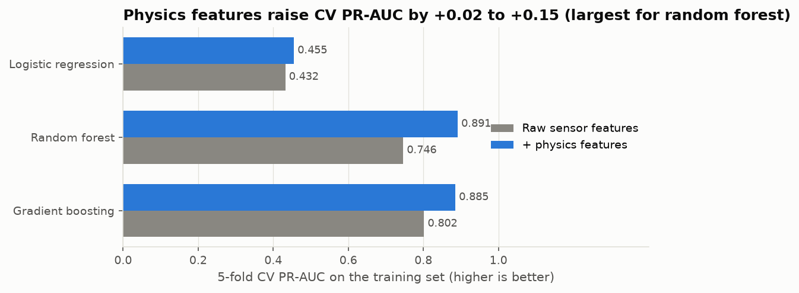

With 5-fold CV on the training set, the physics features raised PR-AUC from 0.746 to 0.891 for random forest, from 0.802 to 0.885 for gradient boosting, and from 0.432 to 0.455 for logistic regression. Logistic regression gains little because failure is dangerous at *both* ends of the power band, which one linear weight can't express.

## 6. Method

**Validation design**

* A stratified 80/20 split. The 2,000-job test set (68 failures) was used **once**, at the end.
* Every choice was made with 5-fold stratified CV on the training set: feature set, hyper-parameters, alarm threshold and final model.
* Preprocessing lives inside a scikit-learn `Pipeline`, so it is re-fitted within each fold.

**Models**

* Two baselines with no learning: *never alarm* and *replace at 200 min*.
* Logistic regression, chosen for transparency, with balanced class weights.
* Random forest, which handles thresholds and interactions, with balanced class weights.
* Gradient boosting (`HistGradientBoostingClassifier`), usually the strongest choice on tabular data.

**Tuning.** A grid search scored by PR-AUC, the right metric for a rare positive class. The best cross-validated PR-AUC was 0.486 for logistic regression (C = 0.1), 0.897 for random forest (depth 16, 3 samples per leaf) and 0.893 for gradient boosting (learning rate 0.03, 200 trees, 15 leaves).

**Threshold by cost.** For each model, the threshold minimising ₹50,000 × missed failures + ₹2,000 × false alarms was found on *out-of-fold* training predictions. Theory says to alarm when p > 2,000 / 52,000 ≈ 0.04. Gradient boosting had the lowest cross-validated cost (₹16.8 lakh at threshold 0.016, against ₹27.8 lakh at 0.5), so it is the final model. Random forest was a close second at ₹17.1 lakh.

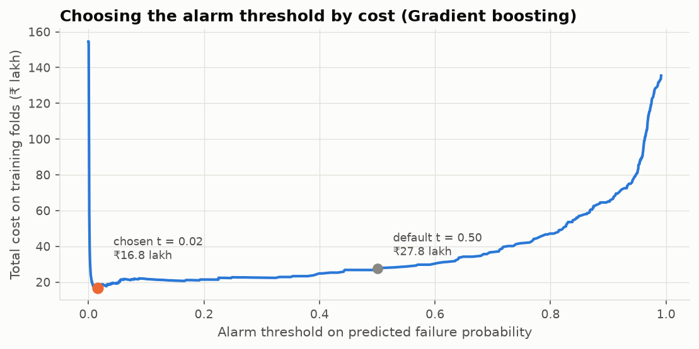

## 7. Results on the held-out test set

| Model | Failures caught | False alarms | Precision | PR-AUC | Cost |
| --- | --- | --- | --- | --- | --- |
| Never alarm | 0 / 68 | 0 | n/a | n/a | ₹34.0 lakh |
| Replace tool at 200 min | 26 / 68 | 149 | 0.15 | n/a | ₹24.0 lakh |
| Logistic regression | 59 / 68 | 277 | 0.18 | 0.440 | ₹10.0 lakh |
| Random forest | 63 / 68 | 132 | 0.32 | 0.891 | ₹5.1 lakh |
| **Gradient boosting** | **65 / 68** | **120** | **0.35** | **0.915** | **₹3.9 lakh** |
| Gradient boosting at threshold 0.5 | 56 / 68 | 2 | 0.97 | 0.915 | ₹6.0 lakh |

* **Uncertainty.** A bootstrap of the test set (1,000 resamples) gives 95% intervals of **90–100%** for recall and **₹2.4–5.8 lakh** for cost. The worst case still beats both baselines by a wide margin.
* **No sign of overfitting.** Test PR-AUC (0.915) is in line with cross-validation (0.893).
* **Accuracy and F1 mislead here.** At 0.5 the same model is more accurate (99.3% vs 93.9%), yet it costs 55% more because it misses 12 failures instead of 3.

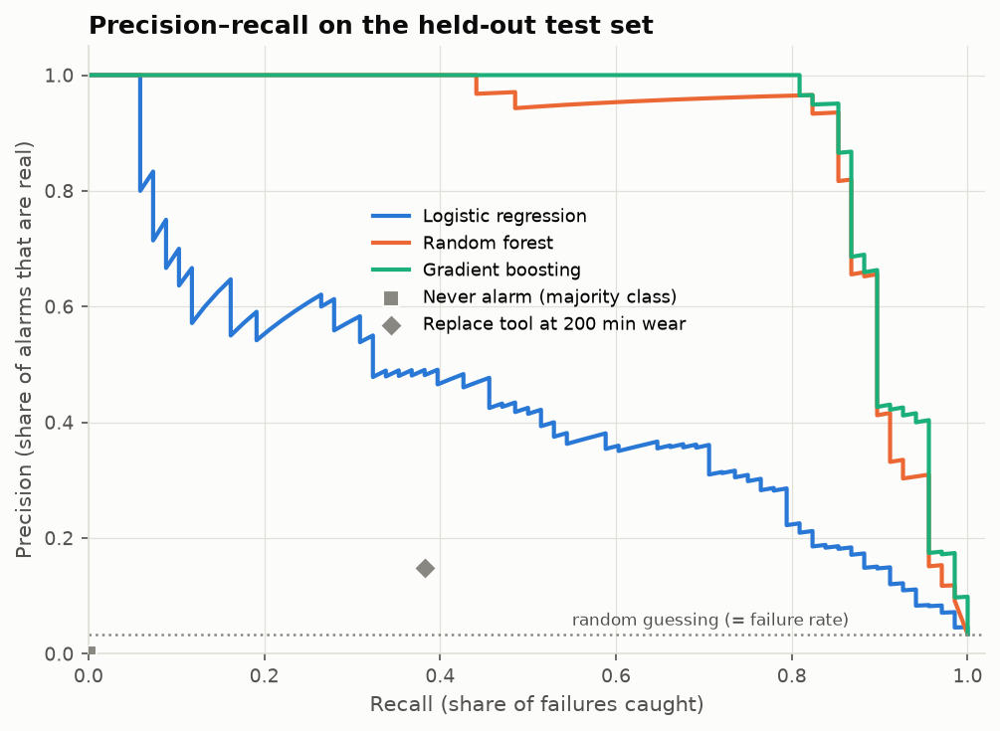

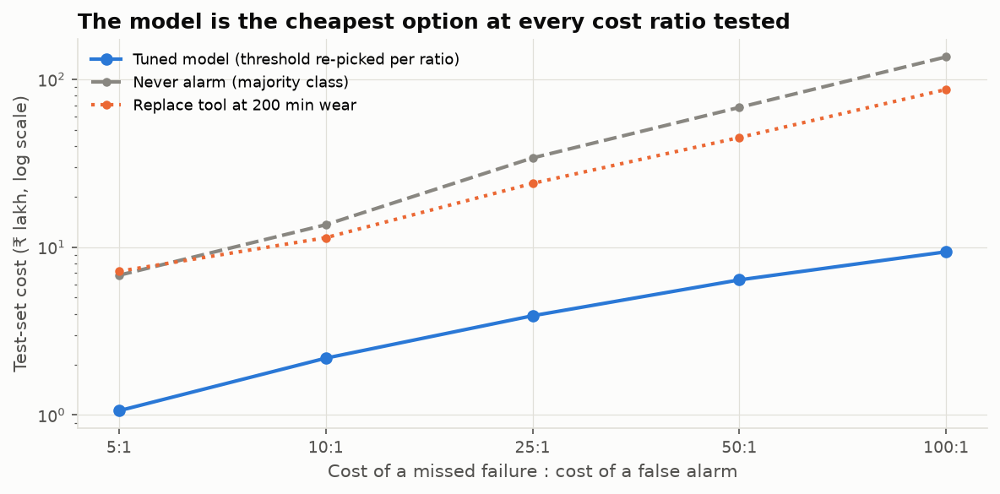

Across cost ratios from 5:1 to 100:1, with the threshold re-picked on training data each time, the model saves 81–89% against the better baseline.

## 8. Error analysis and interpretation

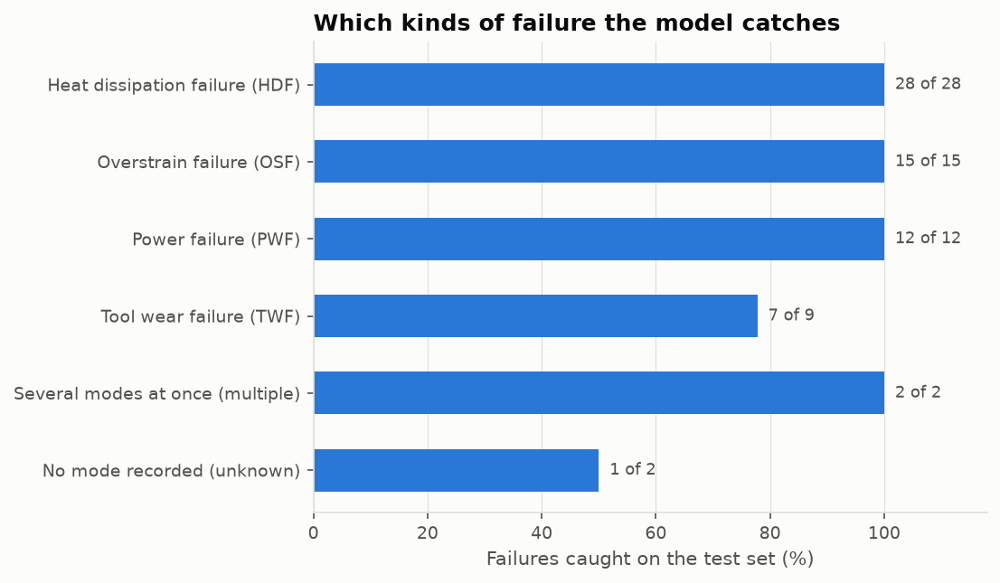

* **What is caught.** Every heat (28), overstrain (15), power (12) and multi-mode (2) failure in the test set.
* **What is missed.**
    * Two tool-wear failures, at 198 and 200 min of wear and moderate torque. The data documentation says tools fail at a *random* time between 200 and 240 min, so these can't be predicted from the sensors.
    * One failure with no recorded mode.
* **The false alarms.** 108 of the 120 are on tools with 190 min of wear or more. These are tools close to replacement anyway, so in practice those inspections are not wasted.

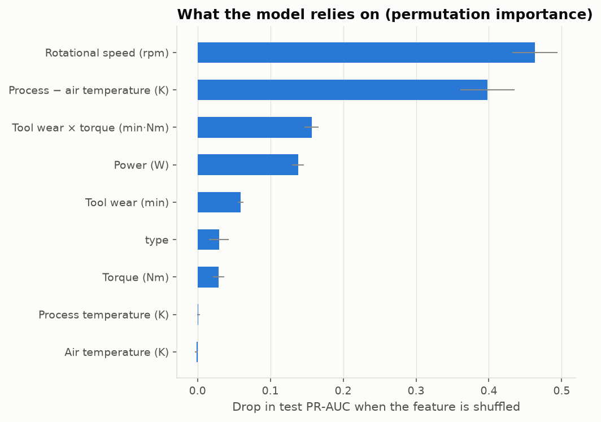

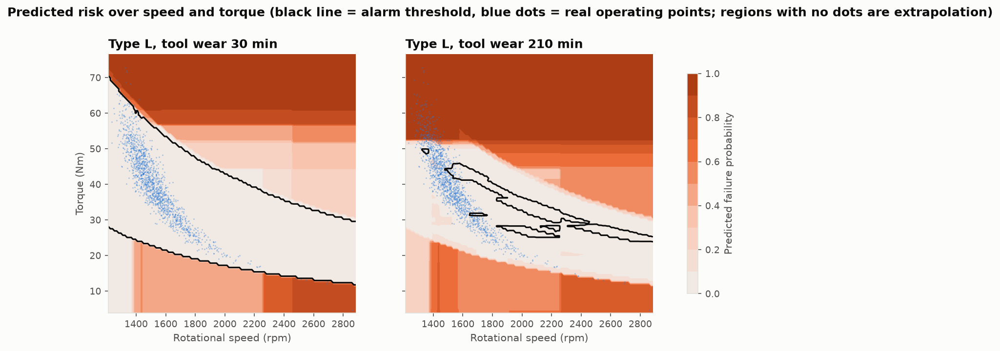

* **Fresh tool.** For a type L part with a fresh tool, the model's safe zone is the band between two hyperbolas. That is the 3,500–9,000 W power band, learned from data.
* **Worn tool (210 min).** Torque above about 52 Nm becomes high-risk. Since 11,000 / 210 ≈ 52, the model **rediscovered the overstrain limit for L parts**.
* **Operator rule.** As the tool wears, keep torque below about 11,000 ÷ wear (min) Nm for L parts, and keep spindle power within about 3.5–9 kW.

## 9. Limitations, bias and next steps

**Limitations and bias**

* **Synthetic data.** The model mostly recovers the rules used to generate the data. Real sensor data is noisier, so real-world scores will be lower.
* **No time sequence or machine ID.** Real predictive maintenance relies on trends over time and needs a time-ordered split.
* **Assumed costs.** The model ranking is robust to them, but the threshold should be set from the plant's real costs.
* **Unpredictable failures.** Random tool-wear failures and unrecorded-mode failures can't be predicted from these sensors, and the labels have small inconsistencies.
* **Imbalance across types.** Type H has only 21 failures, so the model is least reliable for H parts. With 68 failures in the test set, each miss moves recall by 1.5 points.

**Next steps**

1. Predict the failure *mode*, so the alarm says what to do: change the tool, reduce load, or check cooling.
2. Calibrate the probabilities (isotonic regression) so the threshold follows directly from the cost formula.
3. Give logistic regression band features (distance outside the safe power band) to get a transparent alternative.
4. Validate on real machine logs before use on a shop floor.

## 10. Reproducibility

* `pip install -r requirements.txt`, put `ai4i2020.csv` in `data/`, then run `python run_pipeline.py`. It takes about 2 minutes and rewrites every figure and table in `outputs/`, plus `outputs/metrics.json`.
* `notebooks/AI4I_pipeline.ipynb` walks through the same steps with explanations.
* Seed 42 is set in `src/config.py` and used for the split, the CV folds, the models and the bootstrap.

**Reference.** S. Matzka, "Explainable Artificial Intelligence for Predictive Maintenance Applications", *Third International Conference on Artificial Intelligence for Industries (AI4I 2020)*.
